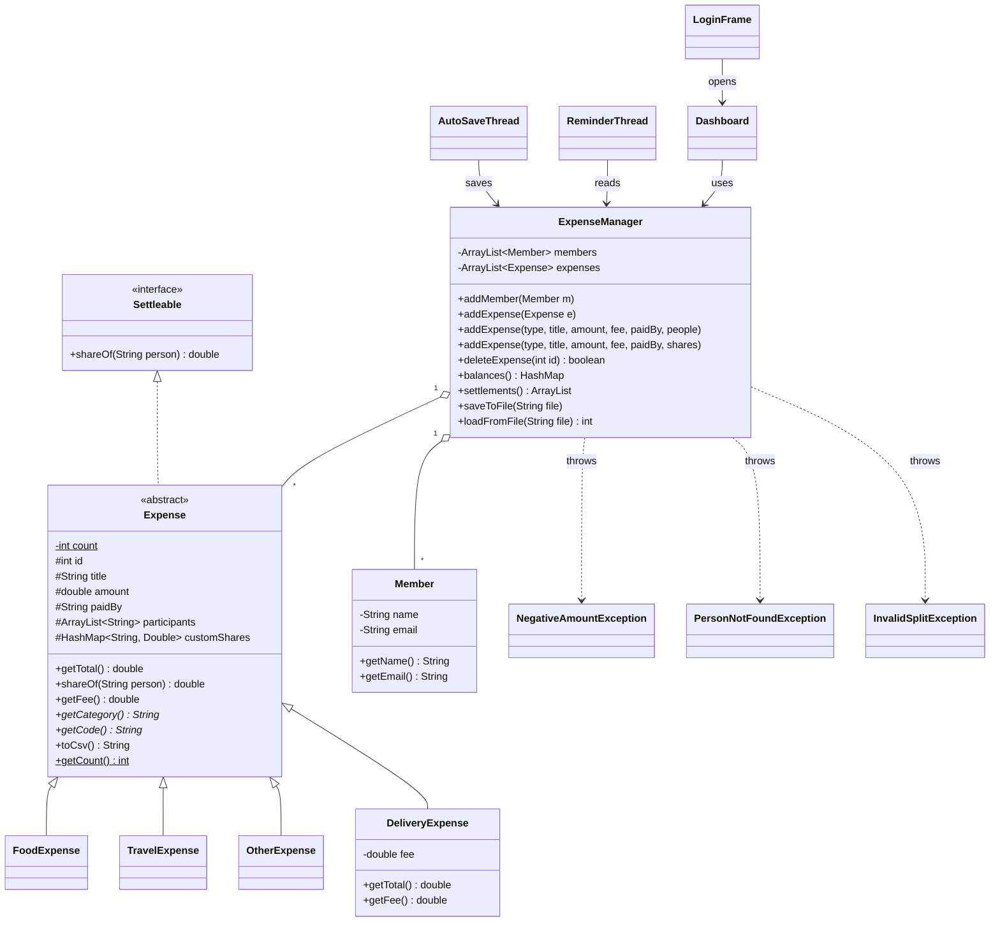

# SplitMate

**Spend together, settle easily.**

SplitMate is a Java Swing desktop application that helps a group of friends record shared expenses, split them equally or by custom amounts, and see exactly who owes whom.

| | |
|---|---|
| **Course** | Object Oriented Technology using Java (CSE2002P) |
| **Developed by** | P.V. Sreeram Sushanth |
| **PRN** | 20250802351 |
| **University** | D.Y. Patil International University, Pune |

---

## Features

- Login screen before the dashboard opens
- Add and view group members
- Record expenses in four categories: **Food**, **Food Delivery** (with a delivery fee), **Travel** and **Other**
- **Equal split** between the selected people, or a **custom split** such as `Durga=200, Ravi=300`
- Delete an expense
- Live balance for every member (who gets money back and who has to pay)
- **Settlement suggestions**: "X pays Y : Rs N" using the smallest number of payments the algorithm can find
- **Auto-save** in a background thread, and a **reminder** thread
- Data stored in a plain text file and reloaded on the next start
- Input validation with user-defined exceptions

---

## OOP Concepts Used

| Concept | Where it is used |
|---|---|
| **Abstraction** | `Expense` is an `abstract` class with abstract methods `getCategory()` and `getCode()` |
| **Interface** | `Settleable` declares `shareOf(String person)`; `Expense` implements it |
| **Inheritance** | `FoodExpense`, `DeliveryExpense`, `TravelExpense` and `OtherExpense` extend `Expense` |
| **Polymorphism (overriding)** | Each expense type supplies its own `getCategory()`, `getCode()` and, where needed, `getTotal()`; the manager works with `Expense` references |
| **Method overloading** | `ExpenseManager.addExpense(...)` has three forms: a ready `Expense` object, an equal split, and a custom split |
| **Constructors** | Default, parameterized and copy constructors in `Expense` |
| **Encapsulation** | Private and protected fields with getters; `getMembers()` and `getExpenses()` return copies |
| **Static members** | `Expense.count` and `Expense.getCount()` generate unique expense IDs |
| **Packages** | `model`, `service` and `ui`, imported across packages |
| **Exception handling** | Three user-defined exceptions, `throws` declarations, and `finally` for closing files |
| **Multithreading** | `AutoSaveThread` and `ReminderThread`; shared data in `ExpenseManager` is protected with `synchronized` methods |
| **File I/O** | `FileWriter` to save and `Scanner` to load |
| **Collections** | `ArrayList` for members and expenses, `HashMap` for balances and custom shares, `Iterator` for safe deletion |
| **GUI** | Swing: `LoginFrame` and `Dashboard` |

---

## Project Structure

```
SplitMate/
├── Main.java
├── model/
│   ├── Settleable.java              (interface)
│   ├── Expense.java                 (abstract class)
│   ├── FoodExpense.java
│   ├── DeliveryExpense.java
│   ├── TravelExpense.java
│   ├── OtherExpense.java
│   ├── Member.java
│   ├── NegativeAmountException.java
│   ├── PersonNotFoundException.java
│   └── InvalidSplitException.java
├── service/
│   ├── ExpenseManager.java          (business logic)
│   ├── AutoSaveThread.java
│   └── ReminderThread.java
├── ui/
│   ├── LoginFrame.java
│   └── Dashboard.java
└── screenshots/
```

---

## UML Class Diagram



---

## How the Settlement Works

1. For every member: **balance = total paid − total share**.
   A positive balance means the member should get money back, and a negative balance means they owe money.
2. Repeatedly take the **biggest creditor** and the **biggest debtor**.
3. The debtor pays the creditor `min(credit, debt)`. Update both balances.
4. Stop when nobody owes anything.

**Example:** Sreeram paid Rs 900 for dinner shared equally by Sreeram, Durga and Ravi. Each share is Rs 300, so Durga pays Sreeram Rs 300 and Ravi pays Sreeram Rs 300.

---

## How to Run

Requirements: JDK 8 or later.

Open Command Prompt or a terminal **inside the `SplitMate` folder**:

```
javac Main.java model/*.java service/*.java ui/*.java
java Main
```

**Login:** username `sreeram`, password `1234`

Data is saved to `splitmate.txt`, created automatically in the same folder.

**Custom split format:** `Durga=200, Ravi=300`

---

## Screenshots

| Login | Dashboard |
|---|---|
|  |  |

| Add Expense | Settlements |
|---|---|
|  |  |

---

## Possible Improvements

- Store data in a database instead of a text file
- Export a settlement report as PDF
- Support multiple groups
- Add currency conversion for trips

---

## Author

**P.V. Sreeram Sushanth**
B.Tech CSE (AI & Data Science), D.Y. Patil International University, Pune
GitHub: [buildbysushdev](https://github.com/buildbysushdev)
